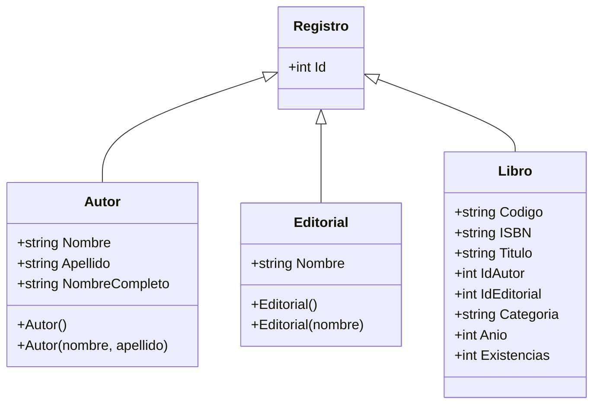
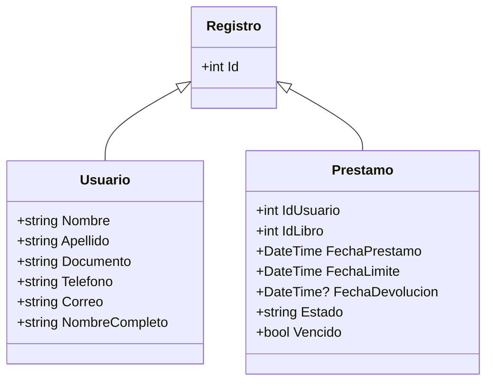
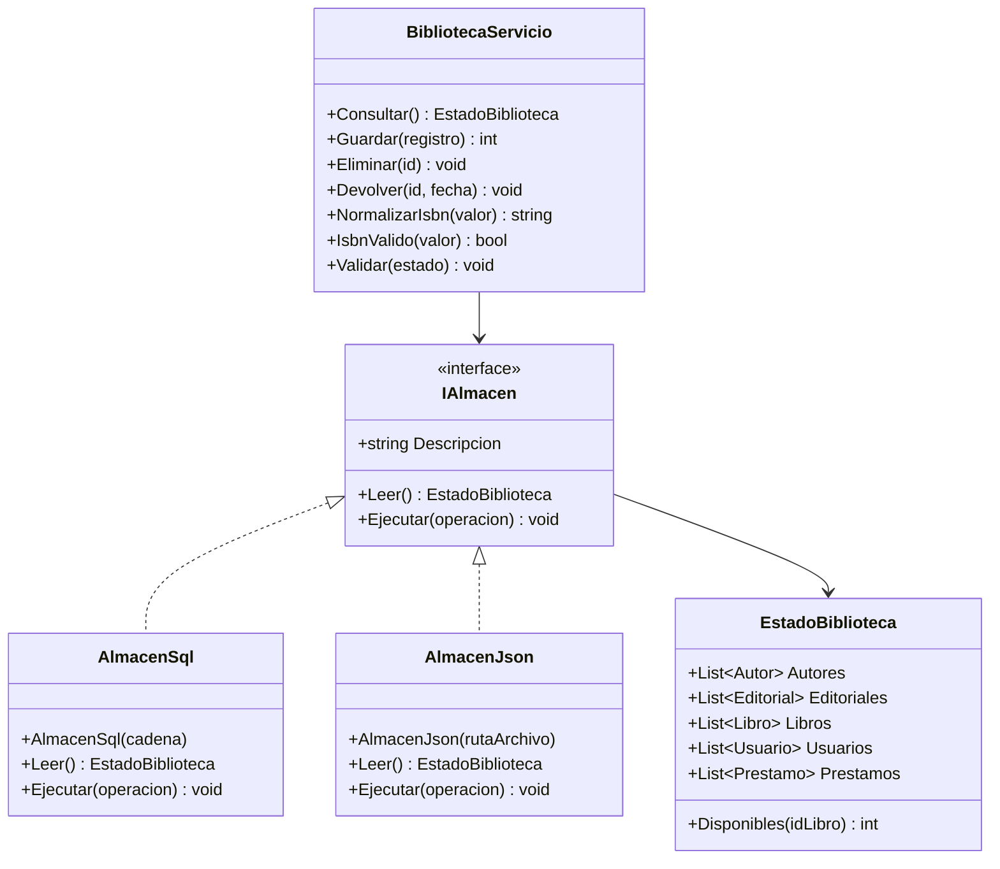
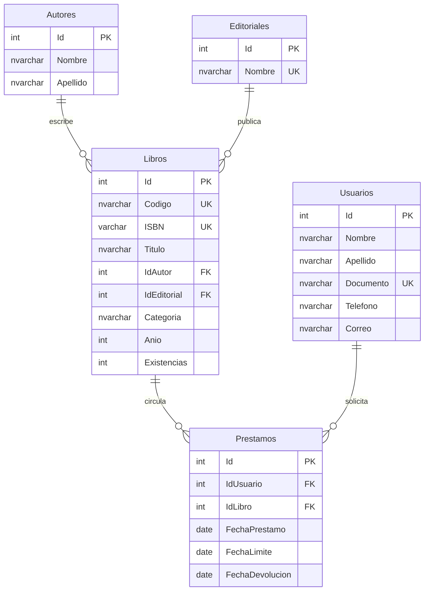

# Diagramas de implementación

## Entidades del catálogo

## Usuarios y circulación

Los constructores por defecto implícitos de Libro, Usuario y Prestamo inicializan propiedades con los valores definidos en Modelos.cs. NombreCompleto, Estado y Vencido son propiedades de solo lectura calculadas.

## Reglas y almacenamiento

Guardar y Eliminar son métodos genéricos restringidos a Registro. Ejecutar recibe una Action de EstadoBiblioteca. Se abrevia la firma para legibilidad del diagrama; el código es la definición completa.

## Modelo relacional

Estado es una columna computada de Prestamos. FechaDevolucion admite NULL. Ver las longitudes, índices y restricciones en SQL/01_Crear_Biblioteca.sql.
