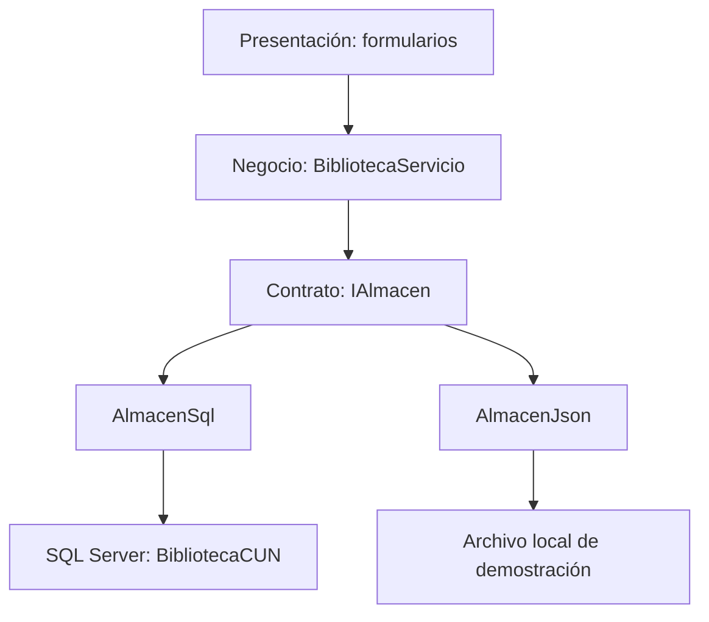
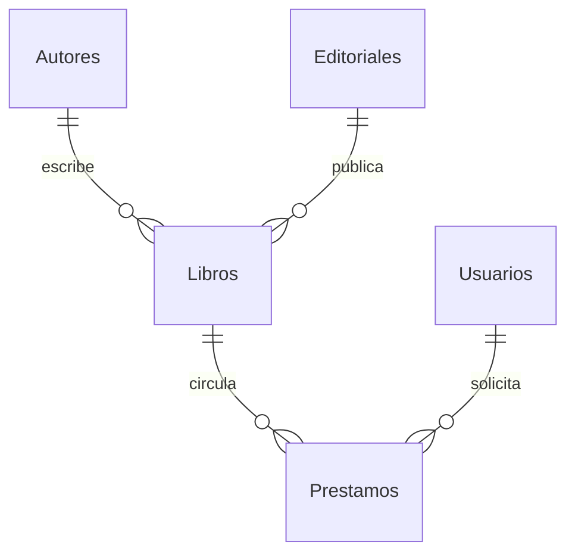

# Sistema de Gestión de Biblioteca

> **Portada académica pendiente de confirmación por el usuario.** Los datos de identificación iniciales son provisionales; no se completa todavía docente, ficha ni modalidad individual/grupal.

**Corporación Unificada Nacional de Educación Superior - CUN**  
**Asignatura:** Programación Avanzada  
**Estudiante identificada en el material disponible:** Edith Yesenia Vargas Herrera  
**Lugar y fecha:** Bogotá D. C., 9 de noviembre de 2026  
**Entrega:** código reconstruido, versión 1.0

No se consignan docente, ficha ni otros integrantes porque no se verificaron para esta asignatura. La ficha de otra asignatura no se trasladó a esta portada.

**Página 1 - Portada**

## Contraportada

Aplicación académica de escritorio para administrar catálogo bibliográfico, usuarios y circulación de libros. Tecnologías: C#, .NET 8, Windows Forms y SQL Server. El repositorio incorpora una implementación JSON para demostración, sin sustituir el almacenamiento SQL exigido por el ACA.

La entrega se basa en el alcance del documento de Programación Avanzada proporcionado. En ese documento RF03 se titula «Gestión de Categorías», aunque sus acciones describen editoriales; esta implementación sigue esas acciones y ofrece **Editoriales**. Categoría se almacena como texto del libro, sin crear un catálogo adicional.

**Página 2 - Contraportada**

## Tabla de contenido

1. Introducción, problema y objetivos - página 4.
2. Requerimientos y alcance - página 5.
3. Arquitectura y orientación a objetos - página 6.
4. Casos de uso y reglas - página 7.
5. Modelo de datos y diccionario - página 8.
6. Persistencia, SQL y transacciones - página 9.
7. Interfaz y módulos - página 10.
8. Verificación y evidencias - página 11.
9. Conclusiones, recomendaciones y referencias - página 12.

La numeración es una organización editorial del Markdown mediante separadores y rótulos. El número físico de páginas al imprimir depende del visor; Markdown no fija por sí mismo tamaño de página ni paginación automática.

**Página 3 - Contenido**

## 1. Introducción, problema y objetivos

La administración dispersa de libros y préstamos dificulta conocer la disponibilidad, asociar obras con sus autores y recuperar el historial de circulación. La solución centraliza esos registros y separa la captura de datos de sus validaciones y persistencia.

El objetivo general es desarrollar una aplicación de escritorio con C#, Windows Forms y SQL Server para gestionar los procesos de una biblioteca, aplicando programación orientada a objetos e integridad relacional.

Los objetivos específicos son: implementar CRUD de catálogos y usuarios; validar campos, unicidad y relaciones; registrar préstamos y devoluciones coherentes; consultar inventario e historial; organizar el código en capas; y aportar evidencia reproducible de compilación y pruebas.

El alcance es académico y de bajo volumen. No incorpora autenticación propia, perfiles, reservas, multas, códigos de barras, préstamos con múltiples títulos por registro, sincronización JSON-SQL ni migración de la base anterior. Un préstamo relaciona un usuario con un ejemplar de un título. El programa no sustituye una plataforma bibliotecaria institucional con auditoría y controles de acceso completos.

**Página 4 - Introducción**

## 2. Requerimientos y alcance

| ID | Requerimiento implementado | Evidencia en código |
|---|---|---|
| RF01 | CRUD de libros, búsqueda y disponibilidad | FrmLibros; BibliotecaServicio |
| RF02 | CRUD autores y restricciones | FrmAutores; Eliminar<Autor> |
| RF03 | CRUD editoriales según descripción del ACA | FrmEditoriales |
| RF04 | CRUD usuarios, documento único y correo | FrmUsuarios; Validar |
| RF05 | Registro, consulta, edición activa y eliminación de préstamos | FrmPrestamos |
| RF06 | Devolución con estado y disponibilidad coherentes | Devolver; EstadoBiblioteca.Disponibles |
| RF07 | Inventario, catálogos, usuarios e historial, activos/devueltos/vencidos | FrmReportes |
| RF08 | Menú organizado | FrmPrincipal |

Los campos obligatorios se verifican en negocio antes de guardar. Los errores de regla se presentan como advertencias; las excepciones de acceso a datos generan un mensaje de diagnóstico. La capa de negocio no depende de Windows Forms. El SQL usa parámetros para los valores y nombres internos constantes para tablas y columnas. Se previenen documentos, códigos, ISBN y editoriales duplicados.

La exportación CSV representa el conjunto mostrado en pantalla. Los controles de fecha aplican a préstamos; no restringen el inventario ni los catálogos.

**Página 5 - Requerimientos**

## 3. Arquitectura y orientación a objetos

| Proyecto | Responsabilidad |
|---|---|
| Biblioteca.Entidades | Datos del dominio, propiedades y cálculos simples |
| Biblioteca.Datos | Leer estados y ejecutar cambios transaccionales |
| Biblioteca.Negocio | Validar y coordinar operaciones |
| Biblioteca.Presentacion | Capturar entradas, mostrar tablas y mensajes |
| Biblioteca.Pruebas | Comprobar invariantes y persistencia |

Las clases usan propiedades y constructores. `Registro` centraliza Id y las entidades heredan esa identidad. `Autor.NombreCompleto`, `Prestamo.Estado` y `EstadoBiblioteca.Disponibles` encapsulan valores calculados. `BibliotecaServicio` encapsula reglas y copia la entrada antes de modificar el estado persistente. Las colecciones tipadas representan cada tabla.

`IAlmacen` permite polimorfismo entre SQL y JSON sin cambiar el servicio. La interfaz es inyectada por constructor. `FrmCrud` reutiliza layout y acciones en formularios derivados. Las propiedades de datos son mutables para permitir serialización, carga y enlace; las operaciones de la aplicación pasan por el servicio para preservar las reglas.

Véase `DIAGRAMAS.md` para el diagrama de clases completo y los contratos de persistencia. Las propiedades persistidas se detallan en la página 8.

**Página 6 - Arquitectura**

## 4. Casos de uso y reglas

| Caso | Actor y precondición | Flujo y resultado | Alternativa |
|---|---|---|---|
| CU01 Registrar libro | Operador; autor y editorial existentes | Completar datos, Guardar; aparece en catálogo | ISBN/código repetido o inválido: no guarda |
| CU02 Actualizar catálogo | Operador; fila existente | Seleccionar, editar y Guardar | Autor/editorial referenciados no se eliminan |
| CU03 Registrar usuario | Operador | Introducir identificación y datos; Guardar | Documento repetido o correo inválido: rechazo |
| CU04 Prestar | Operador; usuario/libro existentes | Elegir fechas; Guardar; baja disponibilidad | Stock cero o préstamo activo duplicado: rechazo |
| CU05 Devolver | Operador; préstamo activo | Seleccionar fecha y Registrar devolución | Fecha incoherente o devolución repetida: rechazo |
| CU06 Corregir préstamo | Operador; préstamo activo | Cambiar usuario/libro/fechas; Guardar | Devuelto: edición rechazada |
| CU07 Eliminar préstamo | Operador; fila existente | Confirmar eliminación; se borra historial | Cancelar conserva el registro |
| CU08 Reportar | Operador; datos disponibles | Tipo/rango, Consultar y Exportar CSV | Sin filas: se informa |
| CU09 Cambiar conexión | Operador; servidor instalado | Probar y guardar; activa SQL | Conexión fallida: conserva modo anterior |

Reglas centrales: ejemplares totales no negativos; disponibilidad nunca negativa después de operaciones de la aplicación; ISBN-10/13 con checksum; claves únicas; referencias existentes; fecha límite no anterior al préstamo; préstamo no futuro; devolución entre préstamo y hoy. Un usuario solo puede tener un préstamo activo por título. Se permiten préstamos posteriores tras devolver.

La disponibilidad se calcula, no se actualiza con incrementos/decrementos manuales. Esto evita sumar dos veces por una devolución repetida. El estado depende exclusivamente de la presencia de FechaDevolucion.

**Página 7 - Casos de uso**

## 5. Modelo de datos y diccionario

Cada registro de préstamo corresponde a un título y un usuario; no se necesita DetallePrestamos. Las relaciones no usan borrado en cascada.

| Tabla | Campo | SQL | Restricción o significado |
|---|---|---|---|
| Todas | Id | int | PK, > 0; asignado por la aplicación dentro de la transacción |
| Autores | Nombre, Apellido | nvarchar(100) cada uno | Obligatorios |
| Editoriales | Nombre | nvarchar(150) | Obligatorio, único |
| Usuarios | Nombre, Apellido | nvarchar(100) cada uno | Obligatorios |
| Usuarios | Documento | nvarchar(30) | Obligatorio, único |
| Usuarios | Telefono | nvarchar(30) | Opcional, cadena vacía por defecto |
| Usuarios | Correo | nvarchar(150) | Opcional; formato validado por negocio |
| Libros | Codigo | nvarchar(30) | Obligatorio, único |
| Libros | ISBN | varchar(13) | Obligatorio, único; longitud 10/13 en SQL; checksum en negocio |
| Libros | Titulo | nvarchar(200) | Obligatorio |
| Libros | IdAutor | int | FK a Autores.Id |
| Libros | IdEditorial | int | FK a Editoriales.Id |
| Libros | Categoria | nvarchar(100) | Opcional, texto libre |
| Libros | Anio | int | SQL 1..9999; negocio hasta el año siguiente |
| Libros | Existencias | int | Total poseído; 0..1.000.000 |
| Prestamos | IdUsuario | int | FK a Usuarios.Id |
| Prestamos | IdLibro | int | FK a Libros.Id |
| Prestamos | FechaPrestamo | date | Obligatoria |
| Prestamos | FechaLimite | date | Igual/posterior al préstamo |
| Prestamos | FechaDevolucion | date NULL | Ausencia significa activo |
| Prestamos | Estado | Computado | Prestado/Devuelto; no se escribe directamente |

Hay un índice único filtrado sobre (IdUsuario, IdLibro) para préstamos sin devolución, e índices para relaciones y fechas. La vista `vInventario` expone totales, activos y disponibles. Los Id no son IDENTITY: se asignan con máximo + 1 bajo bloqueo transaccional; no modifique manualmente identificadores ni use este esquema como generador distribuido.

**Página 8 - Datos**

## 6. Persistencia, SQL y transacciones

`AlmacenSql` abre una conexión por operación. La lectura obtiene un bloqueo compartido de aplicación y lee las cinco tablas en transacción Serializable. Una escritura obtiene el bloqueo exclusivo del mismo recurso, carga el estado vigente, aplica y valida el cambio, sincroniza solo filas cambiadas y confirma. Una excepción antes del commit revierte el cambio.

Los parámetros llevan SqlDbType explícito y longitud para textos. Los identificadores de tabla/columna se construyen desde constantes internas del repositorio, nunca desde la búsqueda ni desde entradas del usuario. Las cadenas de texto con comillas se envían como valores y no forman parte del código SQL.

El bloqueo `sp_getapplock` serializa las escrituras que usan esta aplicación y evita que dos solicitudes calculen la misma disponibilidad al mismo tiempo. El servicio revisa todo el estado después de cambiarlo. Las escrituras manuales o herramientas externas que omitan el contrato no quedan protegidas por ese bloqueo. Las FK, CHECK y restricciones UNIQUE siguen actuando en SQL, pero el checksum ISBN, fecha respecto a hoy y disponibilidad agregada se validan en negocio, no mediante triggers.

La lectura del estado completo simplifica una solución académica de bajo volumen; no es una estrategia adecuada para millones de registros. Para escalar se recomiendan repositorios por agregado, consultas paginadas y procedimientos transaccionales específicos. Las ediciones normales no incorporan rowversion: dos operadores que editen la misma fila conservarán el último guardado válido. El control de stock sí se evalúa con el estado transaccional vigente.

`AlmacenJson` usa un archivo de bloqueo exclusivo compartido entre instancias y reemplaza el archivo de datos mediante un temporal. Si la validación falla no escribe. La demostración no se replica a SQL.

**Página 9 - Persistencia**

## 7. Interfaz y módulos

El formulario principal tiene menú lateral y área de contenido. La edición actual usa fondo marfil, navegación nude, acciones rosa profundo y tipografía Georgia en títulos con Segoe UI para datos y controles. Las tablas son de solo lectura; para editar se selecciona una fila y se usan los campos inferiores. Los listados y los catálogos se recargan con Actualizar.

| Módulo | Controles y operaciones |
|---|---|
| Inicio | Indicadores: títulos, disponibles, activos, vencidos, usuarios |
| Libros | TextBox, ComboBox autor/editorial, NumericUpDown año/totales, DataGridView |
| Autores | Nombre y apellido; CRUD y filtro |
| Editoriales | Nombre; CRUD y filtro |
| Usuarios | Identificación, nombres y contacto; CRUD y filtro |
| Préstamos | ComboBox usuario/libro; DateTimePicker; CRUD activo y devolución |
| Reportes | ComboBox de tipo, filtros de fecha, DataGridView y CSV |
| Conexión | Selección de almacenamiento, cadena y prueba previa a guardar |

### Capturas reales de funcionamiento

Las siguientes imágenes fueron proporcionadas por el usuario al ejecutar la edición rosa en Windows, el 9 de noviembre de 2026. Se conservan sin alterar los valores mostrados. Las vistas previas recreadas para aprobar el diseño no se usan como evidencia de funcionamiento.

**Figura 1. Inicio y panel general.**

La pantalla inicial muestra 3 títulos, 12 ejemplares disponibles, ningún préstamo activo ni vencido y 1 lector registrado. El historial reciente conserva el préstamo devuelto de Ana Ejemplo. Se observa la conexión a BibliotecaCUN en SQL Server.

*Nota. Captura real del sistema proporcionada por el usuario; datos de prueba.*

**Figura 2. Catálogo de libros.**

Se muestran tres títulos con código, ISBN, autor, editorial, categoría, año, ejemplares totales y disponibilidad. La captura documenta la consulta del catálogo y los campos del formulario; por sí sola no prueba una inserción o edición.

*Nota. Captura real del sistema proporcionada por el usuario; datos de prueba.*

**Figura 3. Gestión de usuarios.**

Se observa el usuario ficticio Ana Ejemplo, con documento DEMO-001 y correo de prueba ana@example.com. El módulo presenta búsqueda y campos para mantener los datos del lector.

*Nota. Captura real del sistema proporcionada por el usuario; datos de prueba.*

**Figura 4. Catálogo de autores.**

La consulta presenta a Gabriel García Márquez, George Orwell y Antoine de Saint-Exupéry. Se incluyen campos de nombre y apellido y acciones de mantenimiento.

*Nota. Captura real del sistema proporcionada por el usuario; datos de prueba.*

**Figura 5. Catálogo de editoriales.**

Se listan Editorial de práctica A y Editorial de práctica B. Son registros de demostración, no una afirmación bibliográfica sobre las ediciones de los libros.

*Nota. Captura real del sistema proporcionada por el usuario; datos de prueba.*

**Figura 6. Préstamos y devoluciones.**

El registro número 1 relaciona a Ana Ejemplo con Cien años de soledad. Se observan préstamo del 09/11/2026, límite del 23/11/2026, devolución del 09/11/2026, estado Devuelto y vencido No.

*Nota. Captura real del sistema proporcionada por el usuario; datos de prueba.*

**Figura 7. Reporte de inventario.**

El reporte consolida tres títulos: 5, 3 y 4 ejemplares totales respectivamente. Todos presentan cero préstamos activos y la misma cantidad disponible, consistente con la devolución registrada. El inventario suma 12 ejemplares disponibles.

*Nota. Captura real del sistema proporcionada por el usuario; datos de prueba.*

**Página 10 - Interfaz**

## 8. Verificación y evidencias

Se compiló la solución completa en Release con SDK 8.0.415; se publicó para win-x64 y se ejecutó un programa de pruebas automatizadas. El registro exacto está en `VALIDACION.md` y `resultado_pruebas.txt`.

Las 23 pruebas comprueban CRUD, ISBN/checksum, normalización, códigos y documentos únicos, formatos, obligatoriedad, relaciones, disponibilidad, devolución repetida, ausencia de stock, restricciones de eliminación, fechas, edición activa, historial devuelto, rollback y dos solicitudes concurrentes para un único ejemplar. Las pruebas usan el servicio real y `AlmacenJson`; no se ha sustituido ese resultado por una prueba de integración SQL.

| Verificación | Estado |
|---|---|
| Compilación de cinco proyectos | Aprobada |
| Publicación Windows x64 | Aprobada |
| 23 pruebas de negocio/JSON | Aprobadas |
| Integridad CRC y extracción del ZIP | Comprobada al empaquetar |
| Ejecución gráfica Windows | Confirmada mediante capturas reales del usuario |
| SQL Server real | Conexión, consulta, préstamo y devolución comprobados en el equipo del usuario |
| Capturas de funcionamiento | Siete figuras reales incorporadas |
| Publicación en GitHub | Pendiente; historial local incluido |

La prueba SQL automatizada optativa crea sus propios registros de práctica y los elimina al finalizar. Su ejecución no está acreditada; las comprobaciones SQL documentadas corresponden a pruebas manuales del usuario en su servidor local. El programa no incluye certificado de firma; el bloqueo de Windows del ejecutable descargado puede persistir.

**Página 11 - Verificación**

## 9. Conclusiones, recomendaciones y referencias

El código reconstruido ofrece los módulos del alcance funcional y separa presentación, reglas y persistencia. Las pruebas automatizadas aportan evidencia sobre las invariantes principales, especialmente la coherencia de disponibilidad y devolución. La compilación comprueba el ensamblaje del código, pero no sustituye una sesión real en Windows ni una validación con SQL Server.

Antes de presentar el ACA, complete los datos de portada pendientes y publique el repositorio en la cuenta que el usuario elija. Las capturas reales y las pruebas manuales del equipo Windows se incorporan en esta versión. Se recomienda ejecutar también la prueba SQL automatizada optativa y la prueba de interfaz si se requiere ampliar la evidencia. Mantenga copias de seguridad de la base y los datos JSON. En un despliegue institucional, agregue autenticación y autorización, auditoría, certificados válidos, firma de publicación, rowversion y consultas paginadas.

### Referencias

Microsoft. (s. f.). *Windows Forms for .NET documentation*. Microsoft Learn. https://learn.microsoft.com/en-us/dotnet/desktop/winforms/?view=netdesktop-8.0

Microsoft. (s. f.). *Install, update, and deploy Microsoft.Data.SqlClient*. Microsoft Learn. https://learn.microsoft.com/en-us/sql/connect/ado-net/download-microsoft-sqlclient-data-provider

Microsoft. (s. f.). *sys.sp_getapplock (Transact-SQL)*. Microsoft Learn. https://learn.microsoft.com/en-us/sql/relational-databases/system-stored-procedures/sp-getapplock-transact-sql

Microsoft. (s. f.). *Smart App Control frequently asked questions*. Microsoft Support. https://support.microsoft.com/en-us/windows/security/threat-malware-protection/smart-app-control-frequently-asked-questions

*Programación Avanzada - ACA Final 2026*. (2026). [Guía de actividad académica proporcionada por el usuario].

**Página 12 - Cierre**
